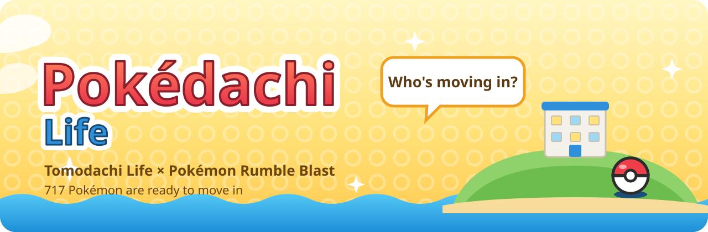
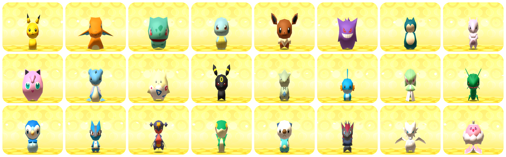
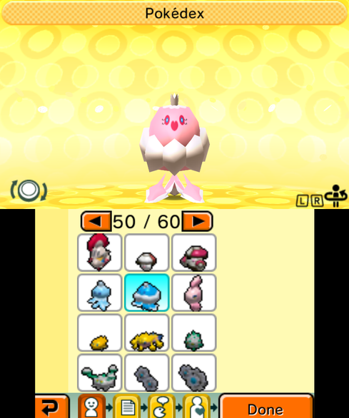
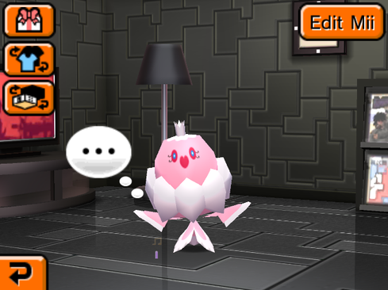
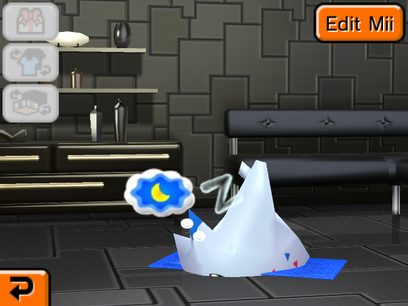
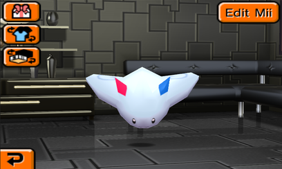
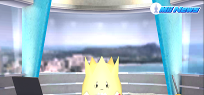
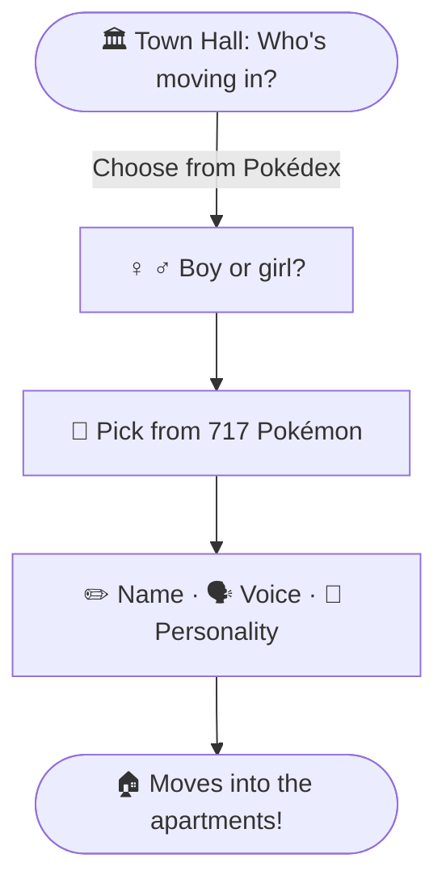
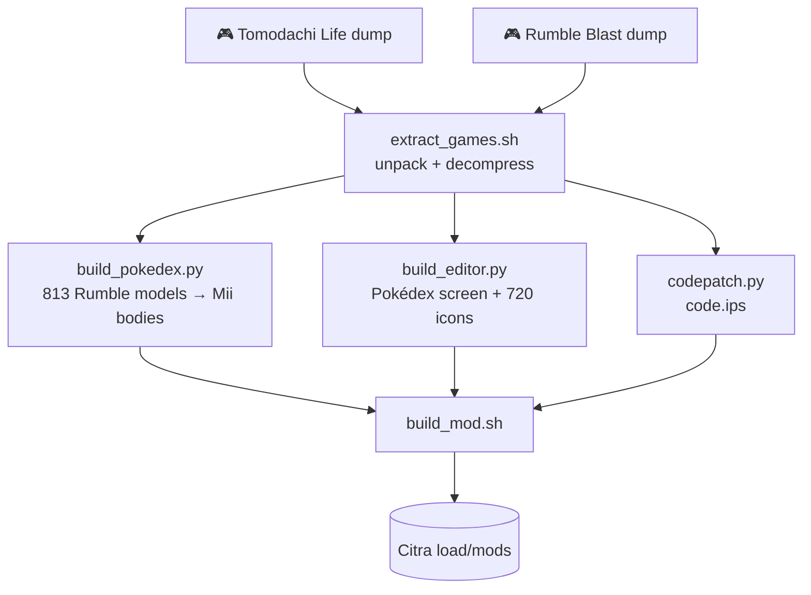

<p align="center">
  
</p>

<p align="center">
  
  
  
  
</p>

<h3 align="center">Tomodachi Life, except every islander is a Pokémon.</h3>

<p align="center">
  Every Pokémon toy from <b>Pokémon Rumble Blast</b> can move onto your <b>Tomodachi Life</b> island.<br>
  They eat, nap, gossip, fall in love, star in Mii News, and you can still pick them up by the head.
</p>

<p align="center">
  
</p>

---

## ✨ What changes

|  | Tomodachi Life | **Pokédachi Life** |
|---|---|---|
| 🏝️ Islanders | Miis | **Rumble Blast Pokémon** with Tomodachi's own animations |
| 🎨 Making a resident | Mii Maker (face, hair, eyes…) | **A Pokédex**: 717 entries over 60 pages |
| ♀️♂️ Gender | Picks clothes | Still asked, and **96 species switch to their female model** (pink Jellicent, heart-tailed Pikachu…) |
| 🗣️ Name, voice, personality | ✔️ | ✔️ unchanged |
| ✋ Grabbing | Pinch the top of the head, slide up | Same gesture: every Pokémon is scaled so its head is where the game expects a Mii's |
| 📰 Mii News | Anchor behind the desk | The anchor sits higher and interviews are reframed so the Pokémon stays in shot |
| 👕 Outfits, hats, accessories | ✔️ | Skipped for now (Pokémon don't wear them… yet) |

<table>
  <tr>
    <td align="center"><br><sub><b>The Pokédex</b> replaces the Mii Maker.<br>Here a girl picks Jellicent and gets the pink one.</sub></td>
    <td align="center"><br><sub><b>Moved in.</b> The game treats it like any other Mii.</sub><br><br><br><sub><b>Nap time</b>, with Tomodachi's own sleep bubbles.</sub></td>
    <td align="center"><br><sub><b>Grab it by the head</b> and it dangles, just like a Mii.</sub><br><br><br><sub><b>Mii News</b>, Pokémon edition.</sub></td>
  </tr>
</table>

---

## 🎬 Who's moving in?



> [!TIP]
> Already have islanders? **Town Hall → Edit Mii → Pokédex** lets you pick a new Pokémon for any of them.
> The page arrows wrap around, so the forms on the last pages are only one tap left of page 1.

---

## 📖 The Pokédex

Every species in Rumble Blast, **#001 Bulbasaur to #646 Kyurem**, in National Dex order, followed by
**71 alternate forms**. A ♀ after a name means that species has a separate female model, which female
islanders get automatically. Tap a generation to open it:

<details>
<summary><b>🌿🔥💧 Gen I · Kanto</b> &nbsp;·&nbsp; #001–#151 &nbsp;·&nbsp; 151 Pokémon &nbsp;·&nbsp; pages 1–13</summary>


`#001` Bulbasaur · `#002` Ivysaur · `#003` Venusaur ♀ · `#004` Charmander · `#005` Charmeleon · `#006` Charizard · `#007` Squirtle · `#008` Wartortle · `#009` Blastoise · `#010` Caterpie · `#011` Metapod · `#012` Butterfree ♀ · `#013` Weedle · `#014` Kakuna · `#015` Beedrill · `#016` Pidgey · `#017` Pidgeotto · `#018` Pidgeot · `#019` Rattata ♀ · `#020` Raticate ♀ · `#021` Spearow · `#022` Fearow · `#023` Ekans · `#024` Arbok · `#025` Pikachu ♀ · `#026` Raichu ♀ · `#027` Sandshrew · `#028` Sandslash · `#029` Nidoran♀ · `#030` Nidorina · `#031` Nidoqueen · `#032` Nidoran♂ · `#033` Nidorino · `#034` Nidoking · `#035` Clefairy · `#036` Clefable · `#037` Vulpix · `#038` Ninetales · `#039` Jigglypuff · `#040` Wigglytuff · `#041` Zubat ♀ · `#042` Golbat ♀ · `#043` Oddish · `#044` Gloom ♀ · `#045` Vileplume ♀ · `#046` Paras · `#047` Parasect · `#048` Venonat · `#049` Venomoth · `#050` Diglett · `#051` Dugtrio · `#052` Meowth · `#053` Persian · `#054` Psyduck · `#055` Golduck · `#056` Mankey · `#057` Primeape · `#058` Growlithe · `#059` Arcanine · `#060` Poliwag · `#061` Poliwhirl · `#062` Poliwrath · `#063` Abra · `#064` Kadabra ♀ · `#065` Alakazam ♀ · `#066` Machop · `#067` Machoke · `#068` Machamp · `#069` Bellsprout · `#070` Weepinbell · `#071` Victreebel · `#072` Tentacool · `#073` Tentacruel · `#074` Geodude · `#075` Graveler · `#076` Golem · `#077` Ponyta · `#078` Rapidash · `#079` Slowpoke · `#080` Slowbro · `#081` Magnemite · `#082` Magneton · `#083` Farfetch'd · `#084` Doduo ♀ · `#085` Dodrio ♀ · `#086` Seel · `#087` Dewgong · `#088` Grimer · `#089` Muk · `#090` Shellder · `#091` Cloyster · `#092` Gastly · `#093` Haunter · `#094` Gengar · `#095` Onix · `#096` Drowzee · `#097` Hypno ♀ · `#098` Krabby · `#099` Kingler · `#100` Voltorb · `#101` Electrode · `#102` Exeggcute · `#103` Exeggutor · `#104` Cubone · `#105` Marowak · `#106` Hitmonlee · `#107` Hitmonchan · `#108` Lickitung · `#109` Koffing · `#110` Weezing · `#111` Rhyhorn ♀ · `#112` Rhydon ♀ · `#113` Chansey · `#114` Tangela · `#115` Kangaskhan · `#116` Horsea · `#117` Seadra · `#118` Goldeen ♀ · `#119` Seaking ♀ · `#120` Staryu · `#121` Starmie · `#122` Mr. Mime · `#123` Scyther ♀ · `#124` Jynx · `#125` Electabuzz · `#126` Magmar · `#127` Pinsir · `#128` Tauros · `#129` Magikarp ♀ · `#130` Gyarados ♀ · `#131` Lapras · `#132` Ditto · `#133` Eevee · `#134` Vaporeon · `#135` Jolteon · `#136` Flareon · `#137` Porygon · `#138` Omanyte · `#139` Omastar · `#140` Kabuto · `#141` Kabutops · `#142` Aerodactyl · `#143` Snorlax · `#144` Articuno · `#145` Zapdos · `#146` Moltres · `#147` Dratini · `#148` Dragonair · `#149` Dragonite · `#150` Mewtwo · `#151` Mew

</details>

<details>
<summary><b>🌸 Gen II · Johto</b> &nbsp;·&nbsp; #152–#251 &nbsp;·&nbsp; 100 Pokémon &nbsp;·&nbsp; pages 13–21</summary>


`#152` Chikorita · `#153` Bayleef · `#154` Meganium ♀ · `#155` Cyndaquil · `#156` Quilava · `#157` Typhlosion · `#158` Totodile · `#159` Croconaw · `#160` Feraligatr · `#161` Sentret · `#162` Furret · `#163` Hoothoot · `#164` Noctowl · `#165` Ledyba ♀ · `#166` Ledian ♀ · `#167` Spinarak · `#168` Ariados · `#169` Crobat · `#170` Chinchou · `#171` Lanturn · `#172` Pichu · `#173` Cleffa · `#174` Igglybuff · `#175` Togepi · `#176` Togetic · `#177` Natu · `#178` Xatu ♀ · `#179` Mareep · `#180` Flaaffy · `#181` Ampharos · `#182` Bellossom · `#183` Marill · `#184` Azumarill · `#185` Sudowoodo ♀ · `#186` Politoed ♀ · `#187` Hoppip · `#188` Skiploom · `#189` Jumpluff · `#190` Aipom ♀ · `#191` Sunkern · `#192` Sunflora · `#193` Yanma · `#194` Wooper ♀ · `#195` Quagsire ♀ · `#196` Espeon · `#197` Umbreon · `#198` Murkrow ♀ · `#199` Slowking · `#200` Misdreavus · `#201` Unown · `#202` Wobbuffet ♀ · `#203` Girafarig ♀ · `#204` Pineco · `#205` Forretress · `#206` Dunsparce · `#207` Gligar ♀ · `#208` Steelix ♀ · `#209` Snubbull · `#210` Granbull · `#211` Qwilfish · `#212` Scizor ♀ · `#213` Shuckle · `#214` Heracross ♀ · `#215` Sneasel ♀ · `#216` Teddiursa · `#217` Ursaring ♀ · `#218` Slugma · `#219` Magcargo · `#220` Swinub · `#221` Piloswine ♀ · `#222` Corsola · `#223` Remoraid · `#224` Octillery ♀ · `#225` Delibird · `#226` Mantine · `#227` Skarmory · `#228` Houndour · `#229` Houndoom ♀ · `#230` Kingdra · `#231` Phanpy · `#232` Donphan ♀ · `#233` Porygon2 · `#234` Stantler · `#235` Smeargle · `#236` Tyrogue · `#237` Hitmontop · `#238` Smoochum · `#239` Elekid · `#240` Magby · `#241` Miltank · `#242` Blissey · `#243` Raikou · `#244` Entei · `#245` Suicune · `#246` Larvitar · `#247` Pupitar · `#248` Tyranitar · `#249` Lugia · `#250` Ho-Oh · `#251` Celebi

</details>

<details>
<summary><b>🌊 Gen III · Hoenn</b> &nbsp;·&nbsp; #252–#386 &nbsp;·&nbsp; 135 Pokémon &nbsp;·&nbsp; pages 21–33</summary>


`#252` Treecko · `#253` Grovyle · `#254` Sceptile · `#255` Torchic ♀ · `#256` Combusken ♀ · `#257` Blaziken ♀ · `#258` Mudkip · `#259` Marshtomp · `#260` Swampert · `#261` Poochyena · `#262` Mightyena · `#263` Zigzagoon · `#264` Linoone · `#265` Wurmple · `#266` Silcoon · `#267` Beautifly ♀ · `#268` Cascoon · `#269` Dustox ♀ · `#270` Lotad · `#271` Lombre · `#272` Ludicolo ♀ · `#273` Seedot · `#274` Nuzleaf ♀ · `#275` Shiftry ♀ · `#276` Taillow · `#277` Swellow · `#278` Wingull · `#279` Pelipper · `#280` Ralts · `#281` Kirlia · `#282` Gardevoir · `#283` Surskit · `#284` Masquerain · `#285` Shroomish · `#286` Breloom · `#287` Slakoth · `#288` Vigoroth · `#289` Slaking · `#290` Nincada · `#291` Ninjask · `#292` Shedinja · `#293` Whismur · `#294` Loudred · `#295` Exploud · `#296` Makuhita · `#297` Hariyama · `#298` Azurill · `#299` Nosepass · `#300` Skitty · `#301` Delcatty · `#302` Sableye · `#303` Mawile · `#304` Aron · `#305` Lairon · `#306` Aggron · `#307` Meditite ♀ · `#308` Medicham ♀ · `#309` Electrike · `#310` Manectric · `#311` Plusle · `#312` Minun · `#313` Volbeat · `#314` Illumise · `#315` Roselia ♀ · `#316` Gulpin ♀ · `#317` Swalot ♀ · `#318` Carvanha · `#319` Sharpedo · `#320` Wailmer · `#321` Wailord · `#322` Numel ♀ · `#323` Camerupt ♀ · `#324` Torkoal · `#325` Spoink · `#326` Grumpig · `#327` Spinda · `#328` Trapinch · `#329` Vibrava · `#330` Flygon · `#331` Cacnea · `#332` Cacturne ♀ · `#333` Swablu · `#334` Altaria · `#335` Zangoose · `#336` Seviper · `#337` Lunatone · `#338` Solrock · `#339` Barboach · `#340` Whiscash · `#341` Corphish · `#342` Crawdaunt · `#343` Baltoy · `#344` Claydol · `#345` Lileep · `#346` Cradily · `#347` Anorith · `#348` Armaldo · `#349` Feebas · `#350` Milotic ♀ · `#351` Castform · `#352` Kecleon · `#353` Shuppet · `#354` Banette · `#355` Duskull · `#356` Dusclops · `#357` Tropius · `#358` Chimecho · `#359` Absol · `#360` Wynaut · `#361` Snorunt · `#362` Glalie · `#363` Spheal · `#364` Sealeo · `#365` Walrein · `#366` Clamperl · `#367` Huntail · `#368` Gorebyss · `#369` Relicanth ♀ · `#370` Luvdisc · `#371` Bagon · `#372` Shelgon · `#373` Salamence · `#374` Beldum · `#375` Metang · `#376` Metagross · `#377` Regirock · `#378` Regice · `#379` Registeel · `#380` Latias · `#381` Latios · `#382` Kyogre · `#383` Groudon · `#384` Rayquaza · `#385` Jirachi · `#386` Deoxys

</details>

<details>
<summary><b>⛰️ Gen IV · Sinnoh</b> &nbsp;·&nbsp; #387–#493 &nbsp;·&nbsp; 107 Pokémon &nbsp;·&nbsp; pages 33–42</summary>


`#387` Turtwig · `#388` Grotle · `#389` Torterra · `#390` Chimchar · `#391` Monferno · `#392` Infernape · `#393` Piplup · `#394` Prinplup · `#395` Empoleon · `#396` Starly ♀ · `#397` Staravia ♀ · `#398` Staraptor ♀ · `#399` Bidoof ♀ · `#400` Bibarel ♀ · `#401` Kricketot ♀ · `#402` Kricketune ♀ · `#403` Shinx ♀ · `#404` Luxio ♀ · `#405` Luxray ♀ · `#406` Budew · `#407` Roserade ♀ · `#408` Cranidos · `#409` Rampardos · `#410` Shieldon · `#411` Bastiodon · `#412` Burmy · `#413` Wormadam · `#414` Mothim · `#415` Combee ♀ · `#416` Vespiquen · `#417` Pachirisu ♀ · `#418` Buizel ♀ · `#419` Floatzel ♀ · `#420` Cherubi · `#421` Cherrim · `#422` Shellos · `#423` Gastrodon · `#424` Ambipom ♀ · `#425` Drifloon · `#426` Drifblim · `#427` Buneary · `#428` Lopunny · `#429` Mismagius · `#430` Honchkrow · `#431` Glameow · `#432` Purugly · `#433` Chingling · `#434` Stunky · `#435` Skuntank · `#436` Bronzor · `#437` Bronzong · `#438` Bonsly · `#439` Mime Jr. · `#440` Happiny · `#441` Chatot · `#442` Spiritomb · `#443` Gible ♀ · `#444` Gabite ♀ · `#445` Garchomp ♀ · `#446` Munchlax · `#447` Riolu · `#448` Lucario · `#449` Hippopotas ♀ · `#450` Hippowdon ♀ · `#451` Skorupi · `#452` Drapion · `#453` Croagunk ♀ · `#454` Toxicroak ♀ · `#455` Carnivine · `#456` Finneon ♀ · `#457` Lumineon ♀ · `#458` Mantyke · `#459` Snover ♀ · `#460` Abomasnow ♀ · `#461` Weavile ♀ · `#462` Magnezone · `#463` Lickilicky · `#464` Rhyperior ♀ · `#465` Tangrowth ♀ · `#466` Electivire · `#467` Magmortar · `#468` Togekiss · `#469` Yanmega · `#470` Leafeon · `#471` Glaceon · `#472` Gliscor · `#473` Mamoswine ♀ · `#474` Porygon-Z · `#475` Gallade · `#476` Probopass · `#477` Dusknoir · `#478` Froslass · `#479` Rotom · `#480` Uxie · `#481` Mesprit · `#482` Azelf · `#483` Dialga · `#484` Palkia · `#485` Heatran · `#486` Regigigas · `#487` Giratina · `#488` Cresselia · `#489` Phione · `#490` Manaphy · `#491` Darkrai · `#492` Shaymin · `#493` Arceus

</details>

<details>
<summary><b>⚡ Gen V · Unova</b> &nbsp;·&nbsp; #494–#646 &nbsp;·&nbsp; 153 Pokémon &nbsp;·&nbsp; pages 42–54</summary>


`#494` Victini · `#495` Snivy · `#496` Servine · `#497` Serperior · `#498` Tepig · `#499` Pignite · `#500` Emboar · `#501` Oshawott · `#502` Dewott · `#503` Samurott · `#504` Patrat · `#505` Watchog · `#506` Lillipup · `#507` Herdier · `#508` Stoutland · `#509` Purrloin · `#510` Liepard · `#511` Pansage · `#512` Simisage · `#513` Pansear · `#514` Simisear · `#515` Panpour · `#516` Simipour · `#517` Munna · `#518` Musharna · `#519` Pidove · `#520` Tranquill · `#521` Unfezant ♀ · `#522` Blitzle · `#523` Zebstrika · `#524` Roggenrola · `#525` Boldore · `#526` Gigalith · `#527` Woobat · `#528` Swoobat · `#529` Drilbur · `#530` Excadrill · `#531` Audino · `#532` Timburr · `#533` Gurdurr · `#534` Conkeldurr · `#535` Tympole · `#536` Palpitoad · `#537` Seismitoad · `#538` Throh · `#539` Sawk · `#540` Sewaddle · `#541` Swadloon · `#542` Leavanny · `#543` Venipede · `#544` Whirlipede · `#545` Scolipede · `#546` Cottonee · `#547` Whimsicott · `#548` Petilil · `#549` Lilligant · `#550` Basculin · `#551` Sandile · `#552` Krokorok · `#553` Krookodile · `#554` Darumaka · `#555` Darmanitan · `#556` Maractus · `#557` Dwebble · `#558` Crustle · `#559` Scraggy · `#560` Scrafty · `#561` Sigilyph · `#562` Yamask · `#563` Cofagrigus · `#564` Tirtouga · `#565` Carracosta · `#566` Archen · `#567` Archeops · `#568` Trubbish · `#569` Garbodor · `#570` Zorua · `#571` Zoroark · `#572` Minccino · `#573` Cinccino · `#574` Gothita · `#575` Gothorita · `#576` Gothitelle · `#577` Solosis · `#578` Duosion · `#579` Reuniclus · `#580` Ducklett · `#581` Swanna · `#582` Vanillite · `#583` Vanillish · `#584` Vanilluxe · `#585` Deerling · `#586` Sawsbuck · `#587` Emolga · `#588` Karrablast · `#589` Escavalier · `#590` Foongus · `#591` Amoonguss · `#592` Frillish ♀ · `#593` Jellicent ♀ · `#594` Alomomola · `#595` Joltik · `#596` Galvantula · `#597` Ferroseed · `#598` Ferrothorn · `#599` Klink · `#600` Klang · `#601` Klinklang · `#602` Tynamo · `#603` Eelektrik · `#604` Eelektross · `#605` Elgyem · `#606` Beheeyem · `#607` Litwick · `#608` Lampent · `#609` Chandelure · `#610` Axew · `#611` Fraxure · `#612` Haxorus · `#613` Cubchoo · `#614` Beartic · `#615` Cryogonal · `#616` Shelmet · `#617` Accelgor · `#618` Stunfisk · `#619` Mienfoo · `#620` Mienshao · `#621` Druddigon · `#622` Golett · `#623` Golurk · `#624` Pawniard · `#625` Bisharp · `#626` Bouffalant · `#627` Rufflet · `#628` Braviary · `#629` Vullaby · `#630` Mandibuzz · `#631` Heatmor · `#632` Durant · `#633` Deino · `#634` Zweilous · `#635` Hydreigon · `#636` Larvesta · `#637` Volcarona · `#638` Cobalion · `#639` Terrakion · `#640` Virizion · `#641` Tornadus · `#642` Thundurus · `#643` Reshiram · `#644` Zekrom · `#645` Landorus · `#646` Kyurem

</details>

<details>
<summary><b>✨ Alternate forms</b> &nbsp;·&nbsp; 71 extra entries &nbsp;·&nbsp; pages 54–60</summary>


- **Unown**: B, C, D, E, F, G, H, I, J, K, L, M, N, O, P, Q, R, S, T, U, V, W, X, Y, Z, !, ?
- **Castform**: Sunny, Rainy, Snowy
- **Deoxys**: Attack, Defense, Speed
- **Burmy**: Sandy Cloak, Trash Cloak
- **Wormadam**: Sandy Cloak, Trash Cloak
- **Cherrim**: Sunshine
- **Shellos**: East Sea
- **Gastrodon**: East Sea
- **Rotom**: Heat, Wash, Frost, Fan, Mow
- **Giratina**: Origin
- **Shaymin**: Sky
- **Arceus**: Fighting, Flying, Poison, Ground, Rock, Bug, Ghost, Steel, Fire, Water, Grass, Electric, Psychic, Ice, Dragon, Dark
- **Basculin**: Blue-Striped
- **Darmanitan**: Zen Mode
- **Deerling**: Summer, Autumn, Winter
- **Sawsbuck**: Summer, Autumn, Winter


</details>

> [!NOTE]
> **Keldeo, Meloetta and Genesect aren't missing by accident.** They hadn't been revealed when
> Rumble Blast came out, so the game only has red placeholder dolls in their slots.

<details>
<summary><b>🎲 Which Pokémon did my old islanders turn into?</b></summary>

<br>

Pokédachi stores the Pokédex number in two Mii features you can't see any more (heads are hidden):
the **hair style** (132 of them) and the **hair colour** (8). Islanders who were already on your island
become whatever their old hairdo points at:

**Pokédex slot = hair style + 132 × hair colour**

| Hair colour (Mii palette order) | They become… |
|:---:|---|
| 1st | #001 Bulbasaur … #132 Ditto |
| 2nd | #133 Eevee … #264 Linoone |
| 3rd | #265 Wurmple … #396 Starly |
| 4th | #397 Staravia … #528 Swoobat |
| 5th | #529 Drilbur … #646 Kyurem, then Unown B … O |
| 6th | Unown P … Winter Sawsbuck, then back to Bulbasaur … Graveler |
| 7th | #076 Golem … #207 Gligar |
| 8th | #208 Steelix … #339 Barboach |

Don't like the result? Edit Mii → Pokédex, pick again. Tapping a Pokémon writes both values for you.

</details>

---

## 🛟 Your island stays yours

- [x] The mod lives only in Citra's mod folder, `load/mods/000400000008C300`. Your save and extdata are
      **never written to**, so installing, updating or removing the mod can't touch your island.
- [x] `build_mod.sh --real` **copies your island out first, every time** (save, extdata and the previous mod
      version) to `Pokedachi-data/backups/citra-<date>-<time>/`.
- [x] Updating to a new version only swaps the files in the mod folder. Your islanders, their friends,
      relationships and items carry on.
- [x] Nothing from anyone's island is in this repository. Saves, extdata, backups and every game file are
      blocked in `.gitignore`.
- [x] **Uninstall:** delete `%APPDATA%/Citra/load/mods/000400000008C300`. Everyone is a Mii again.

> [!IMPORTANT]
> While the mod is installed, the islanders you already have show up as the Pokémon their old hair points
> to (see the 🎲 table above). That alone changes nothing in your save: remove the mod and they're the
> same Miis again. Picking a new Pokémon in Edit Mii *does* get saved, as that islander's hair style and
> colour, so after an uninstall they'd keep the new hairdo. The backups above are there if you want an
> islander back exactly as they were.

---

## 🛠️ Build it yourself

This repo has **no game files**. Everything is built on your PC from **your own** decrypted dumps.

<details open>
<summary><b>What you need</b></summary>

<br>

| | |
|---|---|
| 🎮 Games | Tomodachi Life (USA) and Pokémon Rumble Blast (USA), as decrypted `.3ds` dumps of your own carts |
| 🖥️ Emulator | [Citra](https://github.com/PabloMK7/citra) (tested with nightly 2073) |
| 🪟 OS | Windows 10/11 with Git Bash |
| 🧰 Tools | Python 3.10+ with Pillow, [uv](https://docs.astral.sh/uv/), the .NET 8 SDK, git |

</details>

```bash
git clone https://github.com/radhepa/Pokedachi-Life.git
cd Pokedachi-Life
sh setup.sh                      # fetches SPICA, applies patches/SPICA.patch, builds PokeTool
sh scripts/extract_games.sh "Tomodachi Life (USA).3ds" "Pokemon Rumble Blast (USA).3ds"
sh scripts/build_mod.sh --real   # backs up your island, converts 813 models, installs into Citra
```

Then start Tomodachi Life in Citra and head to the Town Hall. The first build takes a few minutes
(717 Pokémon + 96 female models). After that, `SKIP_BODIES=1 sh scripts/build_mod.sh --real` reuses them.

> [!WARNING]
> Built and tested in Citra only. The same `romfs/` + `exefs/code.ips` should work as a Luma3DS
> LayeredFS mod on a real 3DS, but nobody has tried it yet. Back up your save first if you do.

<details>
<summary><b>⚙️ Settings and paths</b></summary>

<br>

Defaults expect a `Pokedachi-data` folder next to the repo. Override with environment variables:

| Variable | What it is |
|---|---|
| `POKEDACHI_DATA` | where extracted games, build output and backups go |
| `CITRA_DIR` | your Citra user folder (default `%APPDATA%/Citra`) |
| `TOMODACHI_ROM` / `CITRA_EXE` | only for the automated test scripts |
| `NEWS_LIFT` / `INTERVIEW_LIFT` | how far Mii News raises the anchor / interviewee |

</details>

---

## 🔬 How it works



<details>
<summary><b>🧸 Pokémon bodies</b></summary>

<br>

Rumble Blast's Pokémon are little toys: every part (head, body, arms, legs, tail) is a rigid piece on
one bone. `PokeTool` (C#, built on [SPICA](https://github.com/gdkchan/SPICA)) moves each piece onto the
matching bone of a Mii skeleton, so Tomodachi's own 2,700 animations drive them: walking, eating,
sleeping, dancing. Mii heads, hair and hats are switched off through their material templates, and
Pokémon reuse the Mii body material so room lighting looks right.

</details>

<details>
<summary><b>📖 The Pokédex screen</b></summary>

<br>

The Mii Maker's hair page became the Pokédex. A small code patch (`code.ips`) grows it from 132 hair
icons on 11 pages to 720 icons on 60 pages, stores your pick in the hair style + hair colour, and makes
the body loader open `body_pk<slot>[F]` instead of an outfit. The new code lives in unused space at the
end of the game's code, and every patched spot is checked against the expected original instructions
before it's written.

</details>

<details>
<summary><b>🐛 Traps we fell into</b></summary>

<br>

- Pokémon rendered **pitch black** until we found the game wants texture data 0x80-aligned *relative to
  the image block*, not the file.
- Pokémon couldn't be **grabbed**: the game looks for your stylus at a fixed Mii-head height, so every
  Pokémon is now scaled to put its head there.
- Tapping the **blank icons** on the last page once killed the bottom row of buttons for the rest of the
  session. Now they simply re-pick your current Pokémon.

The full engineering log, with addresses and file formats, is in [`MODLOG.md`](MODLOG.md).

</details>

<details>
<summary><b>🗂️ What's in this repo</b></summary>

<br>

| Path | |
|---|---|
| `scripts/build_mod.sh` | builds and installs everything |
| `scripts/build_pokedex.py` | the Pokédex list + model conversion |
| `scripts/codepatch.py` | the ARM code patch (keystone) |
| `scripts/build_editor.py`, `build_text.py` | Pokédex screen, icons and wording |
| `scripts/backup_save.py` | copies your island out before an install |
| `scripts/ctr_extract.py`, `cx.py`, `darc.py`, `bclim.py`, `bclyt.py`, `msbt.py` | 3DS file formats |
| `scripts/citra.py`, `qa_pokedex.py` | drive a test Citra and photograph all 717 entries |
| `scripts/re/` | reverse-engineering helpers (Ghidra headless, capstone) |
| `src/PokeTool/` | CGFX model converter |
| `patches/SPICA.patch` | fixes to SPICA's CGFX writer |

</details>

---

## ❓ FAQ

<details>
<summary><b>Can I download a ready-made mod?</b></summary>

<br>

No. The mod is made of converted Nintendo assets, so it's built locally from your own dumps and never
shared. `build_mod.sh` does it in one go.

</details>

<details>
<summary><b>What about Miis from QR codes or Mii Maker?</b></summary>

<br>

They should just work: the Pokémon is read from each Mii's data whenever its body loads, so a newcomer
becomes whatever its hair points to (see the 🎲 table) and you can change it in Edit Mii. Only
Pokédex-made islanders have been tested so far.

</details>

<details>
<summary><b>Why are there forms like "Arceus (Fire)" in the Pokédex?</b></summary>

<br>

Rumble Blast has a separate toy for each of them, so they're all here: 27 extra Unown letters, the
weather Castforms, Deoxys formes, Rotom appliances, all 16 extra Arceus types, the seasonal Deerling and
Sawsbuck, and more.

</details>

<details>
<summary><b>Does it work with other regions or versions?</b></summary>

<br>

Only Tomodachi Life (USA). `codepatch.py` refuses to patch if the code doesn't match what it expects,
so a different version fails at build time instead of crashing in game.

</details>

---

<p align="center"><sub>
Pokédachi Life is a fan project and isn't affiliated with or endorsed by Nintendo, The Pokémon Company,
Creatures, GAME FREAK or Ambrella. Tomodachi Life and Pokémon Rumble Blast belong to their owners.
This repository contains no game code or assets.
<br>SPICA by gdkchan (public domain) · keystone & capstone · Citra
</sub></p>
